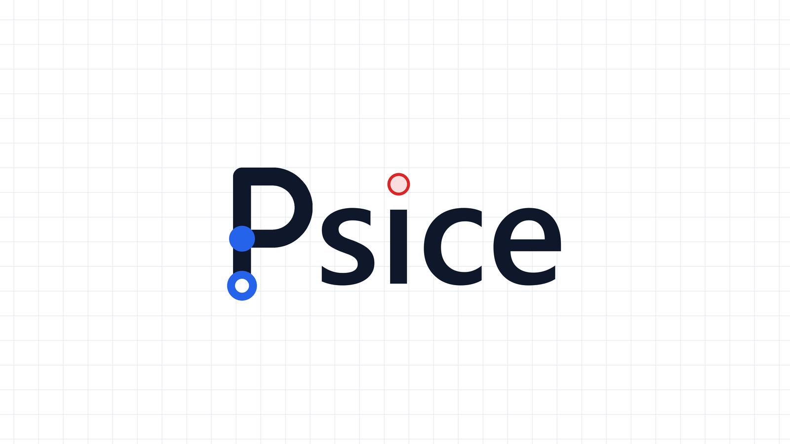
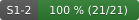

<p align="center">
  
</p>

# Psice 

[](https://github.com/heigvd-2026-pythonge2-a/projet-gazouza/actions/workflows/ci.yml)
[](https://github.com/heigvd-2026-pythonge2-a/projet-gazouza/actions/workflows/ci.yml)
[](https://github.com/heigvd-2026-pythonge2-a/projet-gazouza/issues)


**Jalons :**
[](https://github.com/heigvd-2026-pythonge2-a/projet-gazouza/milestone/1)
[](https://github.com/heigvd-2026-pythonge2-a/projet-gazouza/milestone/2)
[](https://github.com/heigvd-2026-pythonge2-a/projet-gazouza/milestone/3)
[](https://github.com/heigvd-2026-pythonge2-a/projet-gazouza/milestone/4)
[](https://github.com/heigvd-2026-pythonge2-a/projet-gazouza/milestone/5)

Simulateur de circuits électroniques inspiré de LTspice, avec une interface moderne
et ngspice comme moteur de simulation.

Projet de groupe de 2ᵉ année — HEIG-VD.

---

## Objectifs

- Dessiner un schéma électronique dans un éditeur graphique (composants, fils, masse).
- Simuler le circuit avec **ngspice** : point de fonctionnement (.op) et temporel (.tran) en priorité MVP (analyses AC et balayage DC prévues en phase « Important »).
- Afficher les résultats avec une **sonde interactive** : cliquer sur un fil affiche sa tension,
  cliquer sur un composant affiche son courant.
- Livrer une **application Windows** lançable d'un double-clic, sans installation.

### Fonctionnalités prévues

| Priorité | Fonctionnalité |
|---|---|
| MVP | Éditeur de schéma : placement, rotation, fils, grille, zoom |
| MVP | Composants de base : R, C, L, sources de tension et de courant (DC, PULSE, SIN), masse |
| MVP | Génération de netlist SPICE et simulation via ngspice |
| MVP | Visualiseur de courbes avec sonde interactive |
| MVP | Sauvegarde et ouverture des schémas |
| Important | Diodes, amplis-op, transistors (BJT, MOSFET), modèles `.model` / `.subckt` |
| Important | Analyses AC (diagramme de Bode) et DC, balayage de paramètres |
| Important | Animation du courant sur le schéma, annuler / rétablir, copier-coller |
| Important | Import des schémas LTspice (.asc) (restreint aux composants supportés du périmètre) |
| Important | Mesures sur les courbes (crête, moyenne, temps de montée) et export (PNG, CSV, netlist) |
| Bonus | FFT d'une courbe temporelle |

---

## Architecture

```
┌──────────────────────────── Fenêtre pywebview ─────────────────────────────┐
│  Frontend React + TypeScript                                               │
│  ┌──────────────────────┐   ┌────────────────────────┐                     │
│  │ Éditeur de schéma    │   │ Courbes + sondes       │                     │
│  │ (Konva / SVG)        │   │ (uPlot)                │                     │
│  └──────────┬───────────┘   └───────────▲────────────┘                     │
└─────────────┼───────────────────────────┼──────────────────────────────────┘
              │  schéma (JSON)            │  résultats (JSON)
              ▼                           │
┌─────────────────────────── Backend Python (FastAPI) ───────────────────────┐
│  netlist/     schéma JSON → netlist SPICE                                  │
│  importers/   import .asc LTspice                                          │
│  engines/     ngspice                                                      │
└────────────────────────────────────────────────────────────────────────────┘
```

- Le **frontend** ne fait que l'affichage et l'édition. Toute la logique de simulation est dans le backend.
- Le **contrat d'API** (format du schéma et résultats) est défini en Python avec Pydantic.
  Les types TypeScript du front sont générés à partir du schéma OpenAPI de FastAPI
  (`openapi-typescript`), pour que les deux côtés restent synchronisés.
- Tout tourne **en local** : aucun hébergement nécessaire.

### Stack technique

| Partie | Technologies |
|---|---|
| Frontend | React, TypeScript, Vite, Konva (ou SVG), uPlot, Zustand (géré avec **pnpm**) |
| Backend | Python 3, FastAPI, Pydantic, NumPy / SciPy (géré avec **uv**) |
| Simulation | ngspice (binaires Windows inclus dans le projet) |
| Application | pywebview (fenêtre native), PyInstaller (packaging) |
| Qualité | pytest, vitest, ESLint, GitHub Actions |

---

## Structure du repo

```
projet-gazouza/
├── backend/
│   ├── app/
│   │   ├── api/             routes FastAPI
│   │   ├── models/          modèles Pydantic (contrat d'API)
│   │   ├── netlist/         génération de netlist SPICE
│   │   ├── importers/       import .asc LTspice
│   │   └── engines/         intégration ngspice
│   │       └── launcher.py  démarre le serveur et ouvre la fenêtre
│   ├── vendor/ngspice/      binaires ngspice Windows
│   ├── tests/
│   ├── pyproject.toml
│   └── uv.lock
├── frontend/
│   ├── src/
│   │   ├── editor/          éditeur de schéma
│   │   ├── plot/            courbes et sondes
│   │   ├── store/           état de l'application, annuler/rétablir
│   │   └── api/             client vers le backend
│   ├── package.json
│   └── pnpm-lock.yaml
├── shared/
│   ├── openapi.json         contrat d'API exporté (généré)
│   └── fixtures/            circuits de référence partagés front/back
├── website/                 site web et documentation (Astro Starlight)
├── AGENTS.md                instructions pour les assistants IA (+ CLAUDE.md)
├── build.ps1                build complet → application Windows
└── README.md
```

---

## Développement

### Prérequis

- Windows 10 ou 11
- Python 3.12+ & **uv** (`powershell -ExecutionPolicy ByPass -c "irm https://astral.sh/uv/install.ps1 | iex"`)
- Node.js 22.12+ & **pnpm** (`corepack enable` : la version est fixée dans `frontend/package.json`)
- ngspice (binaires Windows inclus dans `backend/vendor/ngspice/`)

### Lancer en mode développement

```powershell
# Terminal 1 — backend
cd backend
uv sync
uv run uvicorn app.main:app --reload

# Terminal 2 — frontend
cd frontend
pnpm install
pnpm dev

# Optionnel : site web / documentation (Astro Starlight)
cd website
pnpm install
pnpm dev
```

Puis ouvrir http://localhost:5173.

Pour ouvrir l'application dans la fenêtre bureau (`pywebview`) avec le frontend compilé (`frontend/dist`) — le launcher démarre alors lui-même le serveur backend local :

```powershell
cd frontend
pnpm build

cd ../backend
uv run python -m app.engines.launcher
```

Pour utiliser la fenêtre bureau avec le serveur de développement Vite (rechargement à chaud), démarrer d'abord les deux serveurs ci-dessus (`uv run uvicorn app.main:app --reload` sur le port `8000` et `pnpm dev` sur le port `5173`), puis lancer dans un troisième terminal :

```powershell
cd backend
uv run python -m app.engines.launcher --dev-url http://127.0.0.1:5173
```

> Avec `--dev-url http://127.0.0.1:5173`, le launcher ne démarre pas de serveur backend : `uv run uvicorn app.main:app --reload` (port `8000`) et `pnpm dev` (port `5173`) doivent tourner en parallèle.

### Vérifications avant commit

Une fois par clone, activer les hooks (ruff et Prettier lancés automatiquement à chaque commit) :

```powershell
cd backend
uv run pre-commit install
```

```powershell
cd backend
uv run pytest                     # tests + fixtures du contrat
cd ../frontend
pnpm test                         # tests unitaires (vitest)
pnpm lint ; pnpm build            # lint + vérification de types
```

### Modifier le contrat d'API

Le contrat est défini dans `backend/app/models/`. Après une modification :

```powershell
cd backend
uv run python scripts/export_openapi.py   # → shared/openapi.json
cd ../frontend
pnpm gen:api                              # → src/api/schema.gen.ts
```

La CI échoue si l'un de ces fichiers générés n'est pas à jour. Les règles de travail
(propriété des modules, contrat, conventions) sont dans [AGENTS.md](AGENTS.md).

---

## Build de l'application Windows

```powershell
.\build.ps1
```

Le script :
1. compile le frontend (`pnpm build`) ;
2. copie le résultat dans le backend ;
3. lance PyInstaller avec ngspice et le front inclus (`uv run pyinstaller ...`).

Résultat : `dist/Psice/Psice.exe`, à distribuer sous forme de dossier zippé.
Aucune installation n'est nécessaire sur la machine cible.

> Au premier lancement, Windows SmartScreen peut afficher un avertissement car l'exécutable
> n'est pas signé : cliquer sur « Informations complémentaires » puis « Exécuter quand même ».

---

## Organisation

4 personnes, environ 90 h chacune.

- **Antoine Bezençon** (chef de projet)
- Damien Bignens
- Noé Guenin 
- Noémi Voélin

| Rôle | Responsabilité | Personne |
|---|---|---|
| Éditeur de schéma | Canvas, placement, fils, sélection, zoom, annuler/rétablir | Noé Guenin  |
| Courbes et sondes | Visualiseur, sonde interactive, curseurs, mesures | Noémi Voélin |
| Bibliothèque et netlist | Composants, modèles SPICE, génération de netlist, import `.asc`, API | Damien Bignens |
| Simulation | Intégration ngspice, analyses, packaging | **Antoine Bezençon** |

### Jalons

| Semaines | Objectif |
|---|---|
| S1–2 | Repo, CI, contrat d'API, ngspice validé sur toutes les machines, prototype netlist → courbe |
| S3–5 | Éditeur basique de bout en bout : dessiner un circuit RC et le simuler |
| S6–8 | Analyses AC et DC, sonde interactive, diodes, amplis-op et transistors, sauvegarde |
| S9–10 | Import `.asc`, annuler/rétablir, mesures et export |
| S11–12 | Tests, stabilisation, build final, rapport et démo |

Chaque jalon est une [milestone GitHub](../../milestones) (`S1-2 : Fondations`,
`S3-5 : Éditeur de bout en bout`, `S6-8 : Analyses et sauvegarde`,
`S9-10 : Import, annuler et mesures`, `S11-12 : Stabilisation et livraison`). Toute issue et
toute PR est rattachée à la milestone du jalon dont elle fait avancer l'objectif ; une PR
reprend celle de l'issue qu'elle ferme. Le pourcentage d'une milestone ne compte que les
issues et PR rattachées : chaque tâche prévue d'un jalon doit donc avoir son issue dès le
début du jalon. Avant de commencer une tâche, on cherche l'issue ouverte qui la couvre et on la
ferme depuis la PR plutôt que d'en créer une nouvelle.

### Issues et labels

Les tâches sont suivies dans GitHub Issues. Chaque issue (et chaque PR) porte en principe un
label `type:` et un label `area:`, plus éventuellement un label `prio:` ou `status:`.

| Famille | Labels | Usage |
|---|---|---|
| `type:` | `bug`, `feat`, `docs`, `test`, `chore`, `question` | Nature du travail (alignée sur les Conventional Commits ; `chore` couvre aussi CI, dépendances et refactor) |
| `area:` | `editor`, `plot`, `backend`, `engine`, `fixtures`, `shared` | Module concerné, donc son propriétaire (voir le tableau ci-dessus et [AGENTS.md](AGENTS.md)) ; `shared` = fichiers à coordonner en équipe |
| `area:` | `contract` | Modification du contrat d'API (`backend/app/models/`) : PR dédiée, relue par les modules qui le consomment |
| `prio:` | `haute`, `basse` | `haute` = bloque une démo ou d'autres modules. Sans label `prio:`, la priorité est normale |
| `status:` | `bloqué`, `à discuter`, `abandonné` | Attend autre chose, demande une décision d'équipe, ou ne sera pas traité (doublon, invalide, hors périmètre) |

Des modèles guident la rédaction (dossier [`.github/`](.github/)) :

- **Issues** : Bug, Fonctionnalité, Contrat d'API, Tâche technique (docs, tests, chore) et
  Question, proposés au moment de créer une issue. Ils posent le label `type:` ; le label
  `area:` est à ajouter à la main, car GitHub ne sait pas le déduire du formulaire.
- **PR** : [`pull_request_template.md`](.github/pull_request_template.md) pré-remplit la
  description (résumé, issue liée, module touché, comment tester, checklist de relecture).

---

## Licence

Ce projet est distribué sous les termes de la **licence MIT**. Voir le fichier [LICENSE](LICENSE) pour plus de détails.

### Logiciels tiers et dépendances

Psice intègre ou utilise des composants externes soumis à leurs propres licences :
- **ngspice** (inclus dans les binaires Windows) : distribué sous licence **BSD 3-Clause**. Les mentions de copyright et les termes de la licence ngspice doivent être conservés lors de la distribution.
- **Dépendances logicielles** : Les bibliothèques tierces (écosystèmes Python et Node.js, `pywebview`, etc.) sont régies par leurs licences respectives (MIT, Apache-2.0, ISC, etc.).