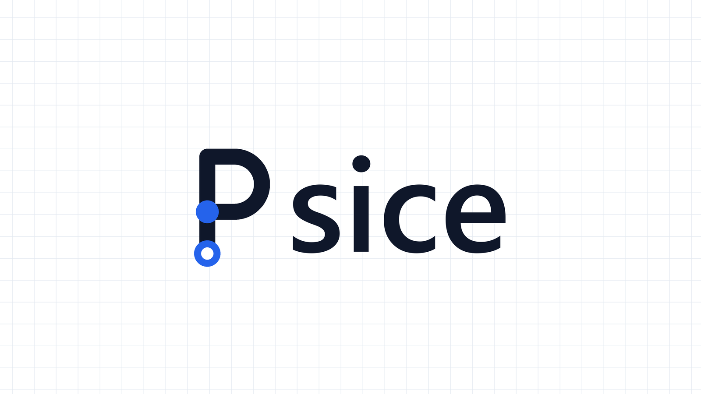
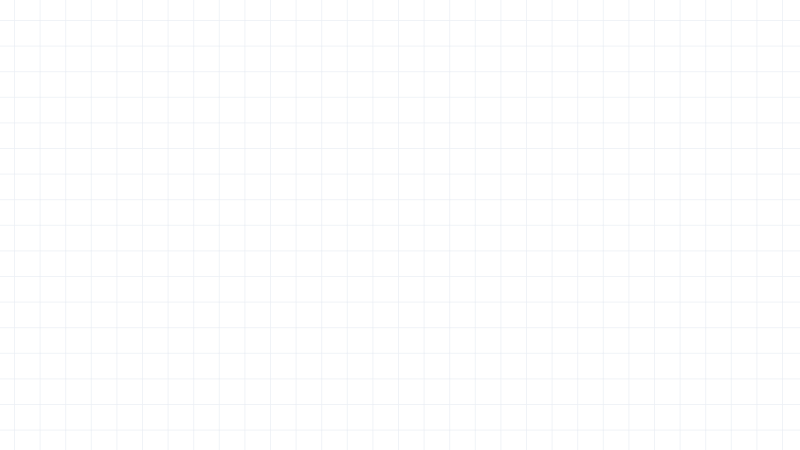

# Logo de Psice

Le logo a été choisi par l'équipe dans l'issue #4 (proposition « Monogramme circuit », version
sobre). Il montre un **P** dont la patte se termine par une **borne de circuit** : un point de
connexion plein et une borne ouverte, comme dans l'éditeur de schéma.

Le grand **P** est la première lettre du nom : il est collé à la suite du mot, **« sice »**, pour
qu'on lise directement **Psice** (et pas « P psice ») — voir l'issue #154.

## Fichiers

| Fichier | Format | Usage |
|---|---|---|
| [`images/psice-logo.png`](images/psice-logo.png) | PNG 1600 × 900, fond quadrillé | README, rapport, présentation |
| [`images/psice-logo-animation.gif`](images/psice-logo-animation.gif) | GIF animé 800 × 450 | Démo orale, écran de démarrage |

## Animation

Le grand **P** se trace en premier (la patte, puis la boucle), le point de connexion et la borne
apparaissent, puis les lettres **s**, **i**, **c** et **e** arrivent une par une, avec le même
curseur bleu que pour le P.

## Couleurs

| Couleur | Code | Où |
|---|---|---|
| Bleu nuit | `#0F172A` | Lettre P et texte « sice » |
| Bleu | `#2563EB` | Point de connexion et borne |
| Blanc | `#FFFFFF` | Fond |

## À faire plus tard

- Une version **SVG** (vectorielle) et une **icône carrée** (le P seul) pour l'icône de
  l'application Windows, le favicon du site et la barre de titre de pywebview.
